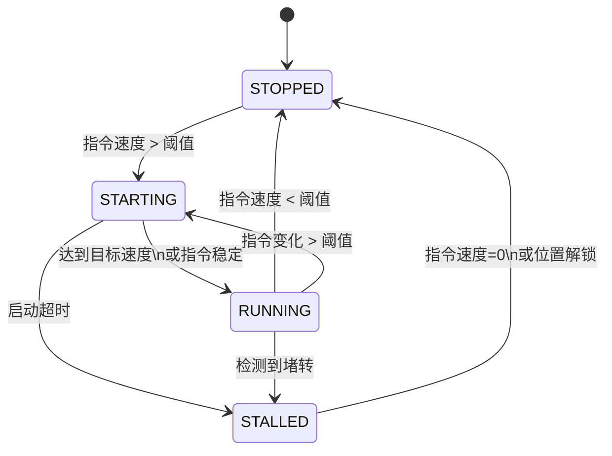

# DJI 2006 电机状态检测与堵转保护模块
**版本：1.2**  
**最后更新：2025-07-20**

## 目录
1. [概述](#概述)
2. [功能特性](#功能特性)
3. [集成指南](#集成指南)
4. [配置参数说明](#配置参数说明)
5. [API 参考](#api-参考)
6. [使用示例](#使用示例)
7. [调试与优化](#调试与优化)
8. [常见问题](#常见问题)
9. [附录](#附录)

---

## 概述
本模块为 DJI 2006 电机提供实时的状态检测和堵转保护功能。系统基于编码器数据（位置和转速），使用状态机模型精确区分电机的四种工作状态：
- **停止状态**：电机未运行或指令速度接近零
- **启动状态**：电机正在加速到目标速度
- **运行状态**：电机正常运行
- **堵转状态**：检测到电机异常

模块支持动态变化的目标值，并能自动适应目标值变化调整检测阈值，确保在各种工况下都能可靠工作。

---

## 功能特性
- **实时状态检测**：每 2ms 更新一次电机状态
- **动态目标值适应**：自动处理目标值变化
- **三重堵转检测**：
    - 转速骤降检测
    - 位置锁定检测
    - 速度异常下降检测
- **自动保护机制**：检测到堵转时自动停止电机
- **状态恢复**：堵转解除后自动重置状态
- **可配置参数**：所有检测阈值均可调整
- **详细状态输出**：实时显示关键运行参数

---

## 集成指南
### 文件结构
```
├── motor_error.h        # 状态定义和接口声明
├── motor_error.cpp      # 状态机实现
└── m2006.cpp            # 应用层实现（主任务）
```

### 依赖项
- STM32 HAL 库
- FreeRTOS 或类似 RTOS
- DJI 电机驱动库
- 编码器读取接口

### 集成步骤
1. 将三个文件添加到项目中
2. 在电机控制任务中包含 `motor_error.h`
3. 初始化状态机（参考[使用示例](#使用示例)）
4. 每 2ms 调用 `update_motor_state()`
5. 根据返回状态执行相应操作

---

## 配置参数说明
所有参数在 `error::MotorStateConfig` 结构中定义：

| 参数 | 类型 | 默认值 | 单位 | 说明 |
|------|------|--------|------|------|
| `zero_speed_thres` | float | 0.5 | rad/s | 接近零速的阈值 |
| `accel_thres` | float | 300 | rad/s² | 加速度阈值（用于检测转速骤降） |
| `position_lock_thres` | float | 0.01 | rad | 位置锁定阈值（小于此值视为位置未变） |
| `lock_time_thres` | float | 0.2 | s | 位置锁定持续时间阈值 |
| `cmd_speed_thres` | float | 2.0 | rad/s | 有效指令速度阈值（大于此值视为有效指令） |
| `dynamic_factor` | float | 0.5 | - | 动态调整系数（随速度增加灵敏度） |
| `start_time_thres` | float | 0.5 | s | 启动超时阈值 |
| `start_speed_ratio` | float | 0.7 | - | 启动成功速度比例（达到指令速度的此比例视为启动成功） |
| `cmd_change_thres` | float | 1.0 | rad/s | 指令变化阈值（超过此值视为指令变化） |

---

## API 参考
### 状态初始化
```cpp
void init_motor_state(MotorStateInfo* state);
```
- 初始化电机状态结构体
- 应在任务开始时调用一次

### 状态更新
```cpp
MotorState update_motor_state(
    MotorStateInfo* state,
    const MotorStateConfig* config,
    float current_speed,    // 当前转速 (rad/s)
    float current_position, // 当前位置 (rad)
    float cmd_speed         // 指令速度 (rad/s)
);
```
- 每 2ms 调用一次
- 返回当前电机状态（枚举值）

### 状态枚举
```cpp
typedef enum {
    MOTOR_STATE_STOPPED,  // 停止状态
    MOTOR_STATE_STARTING, // 启动状态
    MOTOR_STATE_RUNNING,  // 运行状态
    MOTOR_STATE_STALLED   // 堵转状态
} MotorState;
```

---

## 使用示例
```cpp
// 初始化配置
error::MotorStateConfig motor_config = {
    .zero_speed_thres = 0.5f,
    .accel_thres = 300.0f,
    .position_lock_thres = 0.01f,
    .lock_time_thres = 0.2f,
    .cmd_speed_thres = 2.0f,
    .dynamic_factor = 0.5f,
    .start_time_thres = 0.5f,
    .start_speed_ratio = 0.7f,
    .cmd_change_thres = 1.0f
};

// 初始化状态
error::MotorStateInfo motor_state;
error::init_motor_state(&motor_state);

// 目标值变量
float current_target = 0.0f;  // rad/s

// 主任务循环
while (true) {
    // 获取电机状态
    float current_speed = steering_motor->GetOutputShaftOmega();
    float current_angle = steering_motor->GetOutputShaftAngle();
    
    // 更新状态
    error::MotorState state = error::update_motor_state(
        &motor_state, 
        &motor_config,
        current_speed,
        current_angle,
        current_target
    );
    
    // 状态处理
    switch (state) {
    case error::MOTOR_STATE_STARTING:
        // 启动状态处理
        break;
        
    case error::MOTOR_STATE_STALLED:
        // 堵转保护
        steering_motor->SetTarget(0);
        osDelay(1000);
        error::init_motor_state(&motor_state);
        current_target = 0.0f;
        break;
        
    // 其他状态处理...
    }
    
    // 显示状态信息
    const char* state_names[] = {"STOPPED", "STARTING", "RUNNING", "STALLED"};
    print("State: %s | Speed: %.2f rad/s\n", 
          state_names[state], current_speed);
    
    osDelay(2); // 2ms 周期
}
```

---

## 调试与优化
### 关键调试信息
```cpp
// 显示所有关键参数
print("Target: %.2f rad/s | State: %s\n", current_target, state_names[state]);
print("Speed: %.2f rad/s | Accel: %.1f rad/s²\n", 
      current_speed, motor_state.filtered_accel);
print("PosLock: %.1f/%.1f ms | CmdChg: %.1f ms\n", 
      motor_state.position_lock_time * 1000, 
      motor_config.lock_time_thres * 1000,
      motor_state.cmd_info.cmd_change_timer * 1000);
```

### 参数调优步骤
1. **空载测试**：
    - 记录正常启动和运行的参数
    - 测量最大加速度和速度波动范围

2. **堵转测试**：
    - 人为制造堵转，记录检测时间和参数
    - 调整加速度阈值和位置锁定阈值

3. **动态目标测试**：
    - 频繁改变目标值，验证状态切换
    - 调整指令变化阈值减少状态抖动

4. **长期运行测试**：
    - 在实际环境中长期运行
    - 优化参数减少误报

### 推荐调优顺序
1. `zero_speed_thres` (零速阈值)
2. `position_lock_thres` (位置锁定阈值)
3. `accel_thres` (加速度阈值)
4. `cmd_change_thres` (指令变化阈值)
5. `dynamic_factor` (动态调整系数)

---

## 常见问题
### 1. 为什么总是误报堵转？
- 检查加速度阈值是否过低
- 验证位置锁定阈值是否过小
- 确保编码器数据无噪声

### 2. 启动状态持续时间过长？
- 增加 `start_time_thres` (启动超时阈值)
- 降低 `start_speed_ratio` (启动成功速度比例)
- 检查 PID 参数是否合理

### 3. 响应速度不够快？
- 确保每 2ms 调用一次状态更新
- 减小 `lock_time_thres` (锁定时间阈值)
- 增大 `accel_thres` (加速度阈值)

### 4. 如何适应不同负载？
- 根据负载惯量调整 `accel_thres`
- 根据负载特性调整 `dynamic_factor`
- 重型负载可增加 `start_time_thres`

---

## 附录
### 单位转换参考
| 物理量 | 单位 | 转换公式 |
|--------|------|----------|
| 角速度 | rad/s → RPM | RPM = rad/s × 9.5493 |
| 角度 | rad → deg | deg = rad × 57.2958 |
| 加速度 | rad/s² → deg/s² | deg/s² = rad/s² × 57.2958 |

### 典型参数值参考
| 应用场景 | `accel_thres` | `position_lock_thres` | `lock_time_thres` |
|----------|---------------|------------------------|-------------------|
| 轻型负载 | 200-400 rad/s² | 0.005-0.01 rad | 0.1-0.2 s |
| 中型负载 | 400-600 rad/s² | 0.01-0.02 rad | 0.2-0.3 s |
| 重型负载 | 600-800 rad/s² | 0.02-0.03 rad | 0.3-0.5 s |

### 状态转移图


> **注意**：实际使用中请根据具体电机和负载特性调整参数，建议在安全环境下进行充分测试。