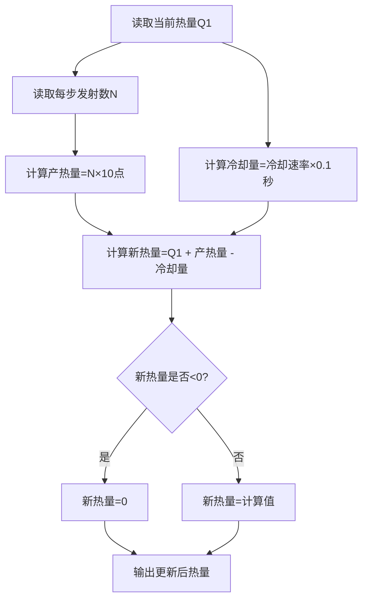
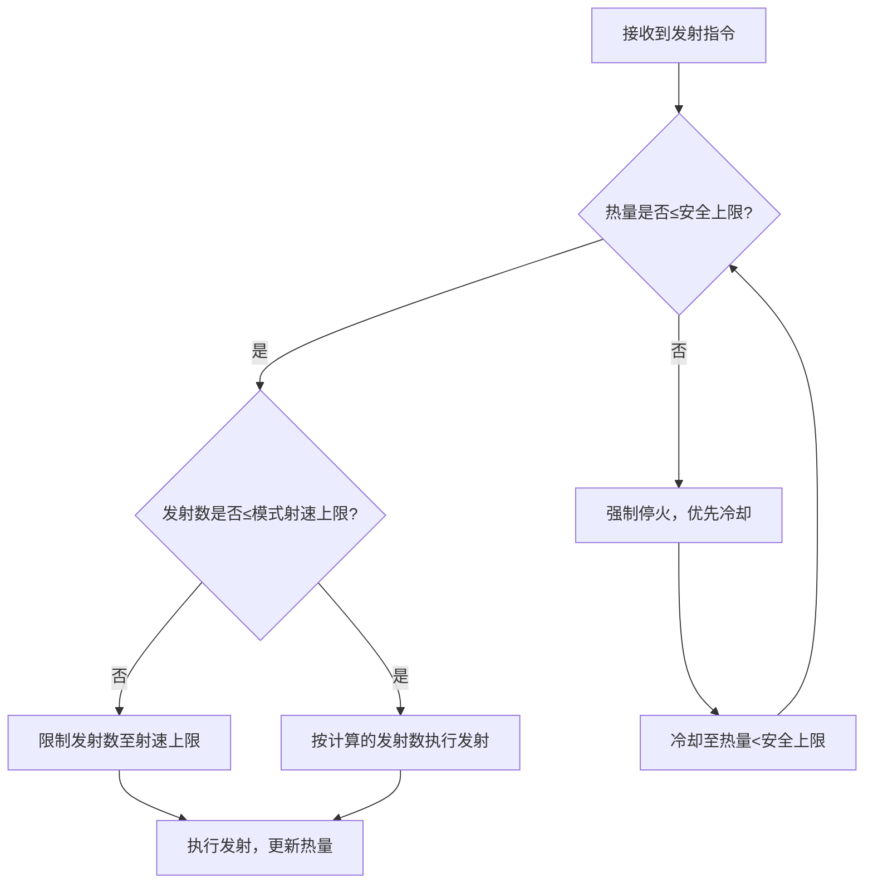

# RoboMaster 2026 射速与热量控制系统 - 核心控制逻辑 README
## 一、核心控制目标
在遵守2026赛季热量规则的前提下，实现点射/双联射/连射（最高30Hz）多模式切换，通过动态热量控制避免发射机构锁定，同时最大化30Hz高射速的战术价值。

## 二、核心控制原理
### 2.1 底层物理/规则原理
1. **产热-冷却失衡原理**：30Hz射速下产热速率（30发/秒 × 10点/发 = 300点/秒）远高于冷却速率（爆发14点/秒、冷却24点/秒），持续发射必然触发热量锁定，因此核心控制逻辑本质是**通过"短时爆发+停火冷却"的动态平衡，将热量约束在安全区间内**。
2. **规则量化原理**：赛事规则将"发射行为"与"热量"做线性绑定（单发射热固定10点），冷却速率为固定值，因此可通过数学公式精准计算"可发射数"和"冷却时长"，实现自动化控制。
3. **缓冲余量原理**：预留10%-15%的缓冲热量（爆发30点、冷却20点），抵消裁判系统10Hz冷却结算的延迟，避免热量"跳级"突破上限。

### 2.2 核心规则依据（控制逻辑的量化基础）
| 维度         | 爆发优先 | 冷却优先 | 控制逻辑关联 |
|--------------|----------|----------|--------------|
| 热量上限(Q0) | 230点    | 88点     | 触发临时锁定，控制的绝对红线 |
| 冷却速率     | 14点/秒  | 24点/秒  | 热量下降的核心计算依据 |
| 单发射热     | 10点/发  | 10点/发  | 产热计算的基础单位 |
| 缓冲热量     | 30点     | 20点     | 抵消结算延迟，安全上限=Q0-缓冲 |
| 安全上限     | 200点    | 68点     | 发射数计算的核心阈值 |

## 三、核心控制逻辑（分模块+逻辑图）
### 3.1 发射数动态计算逻辑
#### 核心公式
```
# 某模式下最大可发射数（不超安全上限）
最大可发射数 = floor((安全上限 - 当前热量) / 单模式产热量)
# 每步（0.1秒，裁判结算频率）最大发射数
每步发射数 = min(round(模式射速 × 0.1), 最大可发射数)
```
#### 模式适配
- 点射（1发/次）：单模式产热量=10点，射速上限5Hz；
- 双联射（2发/次）：单模式产热量=20点，射速上限10Hz；
- 连射（持续连发）：单模式产热量=10点/发，射速上限30Hz。

#### 逻辑图
```mermaid
graph TD
    A[读取当前热量Q1] --> B[读取当前发射模式]
    B --> C{模式类型}
    C -->|点射| D[单模式产热量=10点，射速上限5Hz]
    C -->|双联射| E[单模式产热量=20点，射速上限10Hz]
    C -->|连射| F[单模式产热量=10点，射速上限30Hz]
    D & E & F --> G[计算最大可发射数= floor((安全上限-Q1)/单模式产热量)]
    G --> H[计算每步可发射数=min(round(模式射速×0.1),最大可发射数)]
    H --> I[输出每步发射数]
```

### 3.2 热量更新逻辑
#### 核心公式
```
# 每0.1秒结算一次热量
下一步热量 = max(当前热量 + 发射数×单发射热 - 冷却速率×0.1, 0)
```
#### 关键规则
- 产热仅与发射数相关，与枪管初速、发射模式无额外关联；
- 冷却速率固定，仅随发射机构类型（爆发/冷却优先）变化；
- 热量最低为0，无负热量值。

#### 逻辑图


### 3.3 30Hz连射专项控制逻辑
因30Hz产热速率远高于冷却速率，无法持续输出，采用「短时爆发+停火冷却」循环：

#### 逻辑图
```mermaid
graph TD
    A[触发30Hz连射] --> B[读取当前热量Q1]
    B --> C[计算最大爆发数= floor((安全上限-Q1)/10)]
    C --> D[以30Hz发射最大爆发数，时长=最大爆发数/30]
    D --> E[热量达到安全上限]
    E --> F[强制停火，进入冷却阶段]
    F --> G[计算冷却时长=安全上限/冷却速率]
    G --> H[等待冷却时长，热量降至安全区间]
    H --> I{是否继续触发30Hz连射?}
    I -->|是| B
    I -->|否| J[结束30Hz连射]
```

#### 关键参数（量化结果）
| 发射机构类型 | 最大爆发数 | 爆发时长 | 冷却时长 |
|--------------|------------|----------|----------|
| 爆发优先     | 20发       | 0.667秒  | ≈14.3秒  |
| 冷却优先     | 6发        | 0.2秒    | ≈2.5秒   |

### 3.4 控制优先级（冲突时的执行规则）
#### 逻辑图


#### 优先级排序
1. 缓冲热量优先：任何模式下，发射后热量不得超过安全上限；
2. 射速上限优先：连射不超30Hz，双联射不超10Hz，点射不超5Hz；
3. 冷却优先：热量接近安全上限时，立即停火等待冷却，再恢复发射。

## 四、30Hz非连续输出的核心原因（控制逻辑的必然结果）
1. 物理限制：30Hz产热速率（300点/秒）是冷却速率的21倍（爆发）/12.5倍（冷却），持续发射必超限；
2. 控制适配：逻辑上通过"短时30Hz爆发 + 停火冷却"平衡产热与冷却，确保热量始终在安全区间；
3. 核心结论：30Hz的非连续性是控制逻辑适配冷却速率的必要结果，而非程序漏洞。

## 五、核心逻辑总结
1. 控制的核心是「发射数动态计算+热量实时更新」，以安全上限为阈值，通过数学公式精准平衡产热与冷却；
2. 30Hz控制的本质是"短时爆发+停火冷却"，由产热/冷却速率差决定，无法持续输出；
3. 多模式切换仅适配射速上限和单模式产热量，核心热量控制逻辑统一，且与枪管初速无关联。